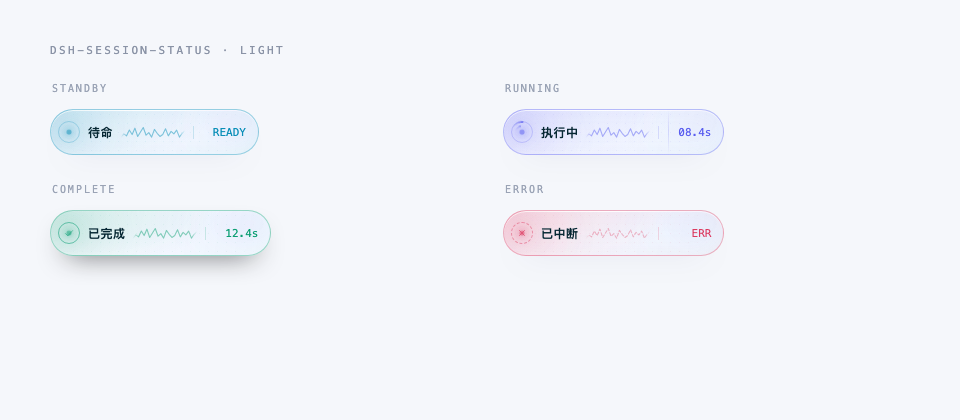
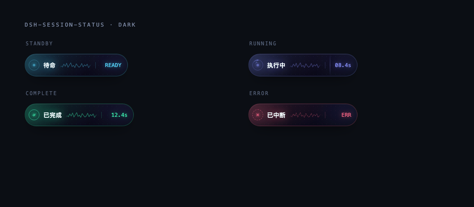

# dsh-session-status · 会话状态光环

给 [DeepSeek Harness](https://github.com/deepseek-ai/deepseek-harness) 的会话状态显示器。它用一枚紧凑的全息状态胶囊回答一个问题：**这个会话正在执行、已经完成，还是被中断了？**

浏览器胶囊悬浮在输入框上方。在 macOS 上，Host 端还可以拉起一个独立的桌面 Pet：它在其他窗口之上、可跨 Space 跟随，并且能拖到屏幕上的任何位置。首次收到会话状态时，桌面 Pet 会自动启动。

## 预览

浅色主题：



深色主题：



## 四种状态

| 状态 | 触发条件 | 视觉 |
|---|---|---|
| **待命** `STANDBY` | 新会话还没有接受过第一条消息 | 青色核心、静止轨道环 |
| **执行中** `EXECUTING` | 会话有正在运行的回合，或消息已被接受但回合尚未可观察 | 紫色反应堆、旋转双环、扫描波形、实时用时 |
| **已完成** `COMPLETE` | 没有运行中的回合，且至少接受过一条消息 | 翡翠核心、描边对勾、上轮用时、一次性冲击波 |
| **已中断** `INTERRUPTED` | 发送失败，或运行中收到无回合归属的 Agent 错误 | 玫红配色、虚线波形、抖动 |

组件只读取 Session 快照（`running`、`awaitingFirstTurn`、`blank`、`promptError`、`lastAgentError`、`removed`）。状态按会话计算，不依赖具体模型：DSH 中所有可用模型（包括 DeepSeek 账号与 API Key 路由）都会展示，不需要额外配置模型 ID。

## 桌面行为

- **拖到任何地方**：按住桌面 Pet 拖到任意屏幕、任意位置，位置会跨启动保存。
- **始终置顶**：Pet 是无边框浮动面板，可加入所有 Space，并覆盖全屏应用。
- **按内容收缩**：桌面 Pet 会读取胶囊的真实内容尺寸并自动调整窗口，文字或计时变长时才扩展，不再保留右侧空白。
- **右键菜单**：在 Pet 上松开右键才弹出「隐藏 / 收回输入框上方 / 重置 / 退出」菜单；右键输入框胶囊弹出「隐藏 / 弹出到桌面 / 收回」。点击「隐藏」后才隐藏当前显示面，Pet 继续在菜单栏安静运行。
- **菜单栏恢复**：点击菜单栏状态图标，可「显示状态」「隐藏状态」「收回输入框上方」「重置到右下角」或「退出桌面状态」。
- **从输入框弹出**：点击浏览器胶囊上的弹出按钮，或直接在 DSH 窗口内拖动胶囊。选择「弹出到桌面」后 Harness 内的胶囊会立即收起，桌面 Pet 成为当前显示面；只有桌面交接失败时才会恢复输入框胶囊。
- **一个开关**：侧栏底部、登录账号入口上方常驻一枚眼睛状态灯；它只控制当前显示面——胶囊在输入框上方时切换输入框胶囊，弹出到桌面后切换桌面 Pet，或按 `⌘⇧H`（非 macOS 为 `Ctrl+Shift+H`）。两种显示面共享同一可见性状态，任一时刻只会出现一个，不会重复。账号行属于官方单实例槽位，因此开关放在其正上方，不覆盖头像与账号菜单。
- **桌面 ↔ 输入框**：桌面 Pet 的右键菜单或菜单栏图标提供「收回输入框上方」，点击后 Pet 收起、输入框胶囊复位；显示面与显示 / 隐藏状态都会跨刷新保留。
- **生命周期**：插件或 DSH 关闭时 Host 会结束桌面 Pet；下次有会话上报状态时会按上次的显示面与可见性恢复（输入框胶囊或桌面 Pet）。

非 macOS 平台会退化为浏览器窗口；原生浮窗仅支持 macOS。

## 安装

### 通过「插件」页面

打开 **插件**，安装 bundle 并指向本目录（或发布后的 tarball / 包名）。本包声明了 bundle patch，因此可以像其他 profile bundle 一样在插件页启用、停用和移除。

GitHub 发布包：[dsh-session-status-0.3.0.tgz](https://github.com/loveJSON/dsh-session-status/releases/latest/download/dsh-session-status-0.3.0.tgz)。也可以在 [Releases](https://github.com/loveJSON/dsh-session-status/releases) 下载对应版本的 tarball，再通过插件页安装。

### 手动安装到 profile

在 `$DSH_HOME/profiles/<profile>/package.json` 中：

```json
{
  "dependencies": {
    "dsh-session-status": "link:/absolute/path/to/deepseek-plug"
  },
  "dsh": {
    "profile": {
      "bundles": [
        "@deepseek-ai/dsh-base",
        "@deepseek-ai/dsh-web-app",
        "dsh-session-status"
      ]
    }
  }
}
```

然后在 profile 目录执行 `pnpm install`。如果 profile 没有 HMR，重启一次 Host 即可。

插件包含一个 Host 入口和一个浏览器入口（`lib/client.js`）。Host 入口提供仅限本机回环地址的状态服务，并按需启动 macOS 桌面伴侣。

## 工作原理

- 完整胶囊注册到 `conversation.input.dock`，排在 Todo、Goal、Queue 之后并紧贴输入框；常驻眼睛开关注册到 `sidebar.footer.action`，位于官方账号入口正上方。
- 胶囊宽度由内容决定（`width: fit-content`），左对齐。
- 眼睛开关只占 28px，用状态点复用待命、执行、完成、中断四种颜色，桌面显示面时状态点变为方形；悬停会区分「显示 / 隐藏会话状态」与「显示 / 隐藏桌面状态」，并显示快捷键，侧栏收起时自动切换为 36px 圆形按钮。
- 通过 `ctx.locale.register('session-status', { zh, en })` 注册中英文案，跟随 DSH 语言实时切换。
- Host 仅监听 `127.0.0.1:47901`。浏览器把当前状态 POST 到该服务，页面和桌面 Pet 通过 SSE 接收更新。Host 还维护一份共享的 `mode + shown` 面板状态，眼睛开关与桌面 Pet 都只修改这一份状态。
- 桌面 Pet 页面通过 `ResizeObserver` 测量胶囊真实宽度，经 WebKit bridge 通知原生窗口收缩或扩展，并持久化窗口尺寸。
- Host 生命周期内第一次收到状态时，会校验 PID 文件并按当前显示面启动 Pet：桌面面直接显示，输入框面以隐藏方式常驻菜单栏。最多重试两次，且不会阻塞状态请求。
- Host 会校验桌面 Pet 的启动协议；插件重载后会替换仍在运行的旧版进程，确保右键菜单等原生交互及时更新。
- 桌面 Pet 在右键按下时拦截、松开后弹出原生菜单，因此打开菜单的手势不会误触「隐藏」；WebView bridge 仍作为非原生宿主中的回退。浮窗隐藏后，菜单栏 `NSStatusItem` 仍然保留。桌面 Pet 自己隐藏或显示后，会通过 `/pet/report` 回报 Host，眼睛开关随即同步。
- 发送信号前会用进程命令行核对 PID 归属，避免过期 PID 误伤无关进程。
- 全部样式由一个 `<style>` 注入，插件卸载时自动移除；`body[data-ds-dark-theme]` 选择深色处理，默认是浅色玻璃面板。
- 动画为纯 CSS，并遵守 `prefers-reduced-motion: reduce`。
- 胶囊以 `role="status"` 暴露给辅助技术，`aria-label` 包含当前状态与提示。

### 自定义

每个状态在 `.dsh-ss[data-phase="…"]` 下暴露 `--ss-accent` 和 `--ss-accent-rgb`。修改 `lib/client.js` 的 `CSS` 块中这两个值即可换色。波形由 `TRACE_TICKS` 数组确定性生成，替换数组即可改变形状。

## 开发

浏览器端没有构建步骤：`lib/client.js` 就是模块系统直接提供的 bundle，只依赖基线模块（`react`、`react-dom`）。

运行中的 Desktop profile 会通过客户端 HMR 感知 `lib/client.js` 的修改。`lib/index.js` 的 Host 改动需要重启 Loader 条目，可在插件页停用再启用。修改 Swift 源码后需要重新编译原生二进制：

```bash
swiftc -O -framework Cocoa -framework WebKit \
  -o native/SessionStatusPet native/SessionStatusPet.swift
```

| 路径 | 作用 |
|---|---|
| `lib/client.js` | 浏览器插件：组件、样式、槽位注册 |
| `lib/index.js` | Host 入口：本地状态服务、SSE、PID 校验、Pet 启动 |
| `native/SessionStatusPet.swift` | macOS 浮窗与菜单栏伴侣 |
| `native/SessionStatusPet` | Apple Silicon 使用的预编译 arm64 伴侣 |
| `cordis.patch.yml` | bundle 层：将 Host 条目插入 profile |
| `locale/*.json` | 插件页标题与描述 |
| `docs/preview-*.png` | 上方状态预览图 |

## 已知限制

- **按回合，不按整个会话。** 「已完成」表示上一回合已经结束、会话空闲，不表示对话已归档或任务永久完成。发送新消息后会回到「执行中」。
- **用时是观察值，不持久化。** 秒表从组件观察到运行态时开始，在最后一次更新时冻结。空闲时刷新页面会显示 `OK`，而不是上一轮历史用时。
- **错误状态是尽力而为。** 使用 Session Controller 的 `promptError` 与 `lastAgentError`；用户主动点「停止」结束的回合会显示为「已完成」。
- **原生 Pet 仅支持 macOS。** 其他平台使用浏览器回退。Intel macOS 会在需要时重新编译 Swift 伴侣，因此要求本机有 Swift 工具链。
- **只能观察 DSH 会话。** 插件只能看到 DeepSeek Harness 内部的会话，无法感知 Codex、其他 IDE 或独立 API 客户端里的 DeepSeek 模型调用。
- **自动启动每次 Host 生命周期只有一次。** 从菜单栏退出桌面状态后，后续状态不会再自动拉起；点击眼睛开关或「弹出到桌面」可按需重新启动。
- **显示面与可见性都会记住。** Host 把显示面（输入框 / 桌面）和显示 / 隐藏状态持久化到 `~/.dsh/session-status-panel.json`，浏览器本地也缓存一份，刷新后按最后一次状态恢复；桌面 Pet 自己隐藏或显示时也会同步到眼睛开关。
- **动画仅作装饰。** 开启「减少动态效果」后胶囊保持静态，波形高光不再移动。

## 许可证

MIT，见 [LICENSE](LICENSE)。
